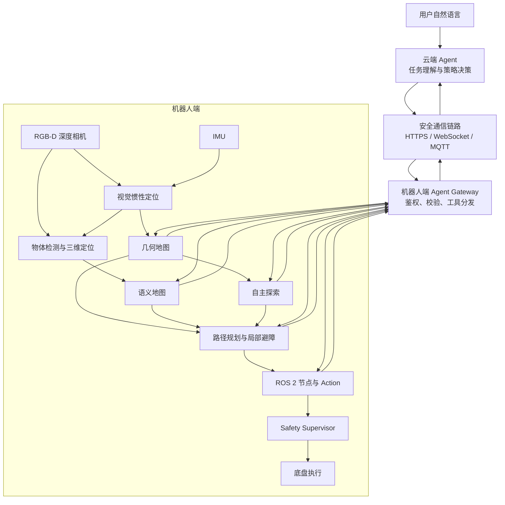

# 云端 Agent 协同的 RGB-D 与 IMU 自主探索语义导航系统项目方案

## 一、项目概述

### 1. 项目名称

**云端 Agent 协同的 RGB-D 与 IMU 自主探索语义导航系统**

### 2. 项目定位

本项目面向室内移动机器人，采用“云端 Agent 决策、机器人端本地感知与执行”的架构。机器人端使用 RGB-D 深度相机和 IMU 完成视觉惯性定位、建图、物体检测、语义地图维护、自主探索和路径规划；云端大语言模型通过安全 API 理解用户指令、分解任务、调整探索策略并处理异常。

云端 Agent 不直接控制底盘，也不输出线速度、角速度或电机控制量。它只能通过工具调用向机器人端提出高层任务请求，机器人端 Agent Gateway 对请求进行身份校验、参数检查、可达性判断和安全审查后，再调用本地 ROS 2 节点执行。

首次探索过程中，机器人建立几何地图和物体级语义地图。用户可以说“帮我探索这个房间并找到会议桌”或“导航到走廊入口的门附近”，云端 Agent 将指令转换为探索、查询和导航任务，机器人端完成实际感知与运动。网络中断时，机器人进入降级模式或安全模式，仍能依靠本地导航和安全控制停止或完成当前安全任务。

### 3. 核心目标

1. 使用 RGB-D 深度相机和 IMU 完成端侧视觉惯性定位与几何建图；
2. 在首次探索过程中识别物体并建立语义地图；
3. 通过云端 Agent 理解自然语言并分解为可执行任务；
4. 通过 Function Calling 或结构化工具调用连接云端决策与机器人端 ROS 2；
5. 根据语义地图生成物体或区域附近的安全目标位姿；
6. 使用本地规划器完成路径规划、避障和底盘控制；****
7. 在后续行驶中增量更新地图、物体状态和环境变化；
8. 在网络异常或云端不可用时保障机器人安全。

### 4. 方案结论

云端 LLM 适合承担任务理解和高层决策，不适合承担实时运动控制。系统采用以下分层：

```text
云端 Agent
    → 理解指令、任务分解、策略调整、异常处理
机器人端 Agent Gateway
    → 工具注册、参数校验、权限检查、超时处理
本地感知与语义
    → RGB-D、IMU、VIO、SLAM、物体检测、语义地图
本地探索与导航
    → Frontier、路径规划、局部避障、底盘执行
Safety Supervisor
    → 速度限制、碰撞检查、急停、通信超时保护
```

## 二、总体架构

### 1. 系统分层

```text
用户自然语言指令
          │
          ▼
云端 LLM Agent
    ├── 指令理解
    ├── 任务分解
    ├── 探索策略调整
    ├── 语义目标选择
    └── 异常处理与任务重试
          │
          │ HTTPS / WebSocket / MQTT
          ▼
机器人端 Agent Gateway
    ├── 会话和身份校验
    ├── 工具调用解析
    ├── 参数及权限检查
    ├── 本地状态汇总
    └── ROS 2 工具分发
          │
          ├───────────────┐
          ▼               ▼
本地感知与建图          本地任务执行
    ├── RGB-D             ├── Frontier 探索
    ├── IMU               ├── 语义查询
    ├── VIO/SLAM          ├── 目标位姿生成
    ├── 点云与深度        ├── 全局路径规划
    ├── 物体检测          ├── 局部避障
    └── 语义地图          └── 底盘控制
          │               │
          └──────┬────────┘
                 ▼
          Safety Supervisor
          速度限制、碰撞检测、
          急停与通信超时保护
```

### 2. 端云职责边界

| 层级 | 主要职责 | 不承担的职责 |
|---|---|---|
| 云端 Agent | 理解自然语言、分解任务、选择高层策略、根据反馈调整任务 | 不直接输出底盘速度，不绕过安全控制 |
| Agent Gateway | 连接 API 与 ROS 2，校验工具调用，汇总状态 | 不替代本地定位和安全控制 |
| 本地感知 | RGB-D、IMU、视觉惯性定位、物体检测和障碍物感知 | 不依赖云端才能输出基本感知结果 |
| 本地语义 | 维护物体、房间、门和空间关系 | 不把未经确认的单帧检测直接作为目标 |
| 本地探索 | Frontier、信息增益、路径代价和探索完成判断 | 不允许云端跳过可达性检查 |
| 本地导航 | 目标位姿、全局规划、局部规划和路径跟踪 | 不接受云端直接下发速度控制 |
| Safety Supervisor | 急停、碰撞保护、速度限制、超时和异常降级 | 不由云端关闭或覆盖 |

### 3. 系统架构图



## 三、机器人端基础能力

### 1. RGB-D 与 IMU 视觉惯性定位

RGB-D 相机提供彩色图像和深度图，IMU 提供角速度与加速度。视觉模块根据图像特征、深度约束和惯性信息估计连续运动，输出相机位姿，再通过相机与机器人之间的外参得到机器人位姿。

定位模块应输出：

- 当前位姿和速度；
- 跟踪状态；
- 位姿置信度或协方差；
- 有效特征数量；
- 深度有效率；
- 是否需要重新定位。

定位质量下降时，机器人端应降低地图更新权重，必要时减速、重新观测或安全停止。云端 Agent 不参与高频位姿估计。

### 2. 几何建图与局部三维感知

深度点云经过坐标变换、范围裁剪、体素降采样和噪声过滤后，更新：

- 二维占据栅格；
- 局部三维体素；
- 地面和可通行区域；
- 障碍物边界；
- 未知区域范围。

二维占据地图服务于全局规划，局部三维体素服务于桌面边缘、悬空物体、低矮物体和临时障碍物检测。端侧实时观测优先于云端历史摘要。

### 3. 物体检测与语义地图

机器人端运行轻量目标检测模型，识别桌子、椅子、门、柜子和项目关注的其他物体。检测结果与深度图结合，估计物体三维位置，再通过当前位姿转换到地图坐标系。

系统通过多帧观测、空间聚类和类别一致性合并重复检测，避免单帧误检直接修改语义地图。每个对象至少记录：

| 字段 | 内容 |
|---|---|
| object_id | 物体唯一标识 |
| category | 物体类别 |
| position | 地图坐标系中的位置 |
| extent | 二维或三维尺寸 |
| region | 所属房间或区域 |
| relations | 与门、墙面、房间和其他物体的关系 |
| confidence | 类别和位置置信度 |
| observed_at | 最近观测时间 |
| status | 稳定、移动、消失或待确认 |
| map_version | 所属地图版本 |

### 4. 自主探索

探索模块根据已知区域和未知区域边界生成候选目标，并综合考虑距离、可达性、未知区域覆盖量、深度观测质量、定位稳定性和安全风险。

云端 Agent 可以根据探索状态建议目标区域或探索模式，但最终目标必须经过机器人端可达性和安全检查。机器人到达探索位置后更新几何和语义地图，再选择下一个目标。

探索结束条件包括：

- 没有可到达的未知边界；
- 覆盖率达到设定目标；
- 剩余未知区域小于阈值；
- 机器人资源或安全状态不允许继续探索。

## 四、云端 Agent 设计

### 1. Agent 任务

云端 Agent 负责：

1. 理解用户自然语言；
2. 将复杂目标分解为探索、查询、导航和确认步骤；
3. 根据机器人端反馈调整探索区域和任务顺序；
4. 处理目标歧义、导航失败和局部不可达；
5. 生成下一次高层工具调用；
6. 向用户解释任务状态和失败原因。

云端 Agent 不负责：

- 高频传感器处理；
- 视觉惯性定位；
- 地图坐标计算；
- 碰撞检测；
- 直接输出线速度和角速度；
- 绕过机器人端安全监督。

### 2. 工具调用接口

建议通过 Function Calling 或结构化工具调用，将云端决策连接到机器人端工具。工具调用必须包含明确的参数模式、超时时间和返回状态。

| 工具名称 | 功能 | 执行位置 |
|---|---|---|
| `get_robot_state` | 获取位置、电量、任务状态和定位质量 | 机器人端 |
| `get_exploration_status` | 获取覆盖率、未知区域和 Frontier 摘要 | 机器人端 |
| `start_exploration` | 启动指定区域或模式的探索 | 机器人端 |
| `pause_exploration` | 暂停探索并保持安全状态 | 机器人端 |
| `query_semantic_map` | 查询物体、房间和空间关系 | 机器人端 |
| `detect_objects` | 请求对当前区域执行物体检测 | 机器人端 |
| `generate_navigation_goal` | 根据语义对象生成安全目标位姿 | 机器人端 |
| `navigate_to_pose` | 请求本地导航到目标位姿 | 机器人端 |
| `get_navigation_status` | 获取导航进度、阻塞原因和结果 | 机器人端 |
| `stop_robot` | 停止机器人运动 | 机器人端，最高优先级 |
| `get_map_summary` | 获取地图版本、覆盖区域和变化摘要 | 机器人端 |
| `request_reobservation` | 请求机器人重新观察指定区域 | 机器人端 |

### 3. 工具调用约束

- 工具名称使用白名单，不允许模型调用未注册工具；
- 参数使用结构化 Schema 校验；
- 目标位置必须携带地图坐标系、时间戳和地图版本；
- 导航前必须检查目标是否可达；
- 任何移动工具调用都要经过 Safety Supervisor；
- 工具调用设置超时、取消和幂等规则；
- 机器人端返回明确的成功、失败、阻塞、取消和过期状态；
- `stop_robot` 不依赖云端确认，机器人端和本地急停均可直接触发。

### 4. 典型任务流程

用户说：“帮我探索这个房间，找到会议桌。”

```text
1. 用户指令发送到云端 Agent
2. Agent 解析为“探索指定区域 + 查询会议桌”
3. Agent 调用 get_robot_state
4. Agent 调用 start_exploration
5. Gateway 校验区域和探索参数，调用本地探索 Action
6. 机器人端执行探索并更新几何地图、物体检测和语义地图
7. Gateway 按事件或低频周期向云端返回探索摘要
8. Agent 调用 query_semantic_map 查询会议桌
9. Agent 调用 generate_navigation_goal
10. 机器人端检查目标物体和可达位姿
11. Agent 调用 navigate_to_pose
12. 本地规划器和 Safety Supervisor 执行导航
13. Gateway 返回到达、失败或不可达结果
14. Agent 向用户反馈任务结果
```

云端 Agent 可以选择下一步任务，但每个实际动作都由机器人端验证和执行。

## 五、自然语言语义导航

### 1. 指令解析

云端 Agent 将用户指令转换为结构化任务，例如：

```json
{
  "task_type": "navigate",
  "target_category": "table",
  "target_region": "meeting_room",
  "relation": "near",
  "selection": "any",
  "map_version": "current"
}
```

机器人端不直接信任自然语言中的坐标或名称，而是根据结构化字段查询本地语义地图。对于“最近的桌子”“会议室里的椅子”“走廊入口的门”等条件，目标筛选和坐标计算由机器人端完成。

### 2. 目标位姿生成

机器人端在目标物体周围生成候选位置，并筛选：

- 与物体保持安全距离；
- 机器人尺寸能够通过；
- 路径和停靠点没有占据障碍；
- 到达后仍可观察目标；
- 目标位姿不位于未知或高风险区域。

如果多个对象都满足条件，机器人端返回候选列表和置信度，由 Agent 选择或向用户请求确认。若没有安全候选，返回“目标可识别但当前不可达”，不允许云端强制执行。

### 3. 导航执行

云端只下发目标级请求，机器人端完成：

1. 地图版本检查；
2. 目标坐标系转换；
3. 当前定位检查；
4. 可达性检查；
5. 全局路径规划；
6. 局部避障和路径跟踪；
7. 到达判定与任务反馈。

路径规划过程中发现新障碍物时，端侧直接减速、停止或重新规划，不等待云端响应。

## 六、端云通信与数据管理

### 1. 建立连接

机器人主动向云端建立安全连接，避免将机器人服务直接暴露在公网。通信可以使用 HTTPS、WebSocket 或 MQTT，具体方式根据网络环境和消息实时性选择。

建议将通信分为：

- 任务请求通道；
- 工具调用和执行反馈通道；
- 状态事件通道；
- 关键帧或困难识别图像的按需上传通道。

### 2. 数据传输原则

不持续上传原始 RGB-D 视频、完整点云和高频 IMU 数据，只向云端发送完成任务所需的摘要。

| 数据 | 上传策略 | 示例 |
|---|---|---|
| 用户自然语言 | 按需上传 | “找到会议桌并导航过去” |
| 机器人状态 | 事件触发或低频上传 | 位姿、电量、定位状态 |
| 地图信息 | 按需上传摘要 | 覆盖率、未知区域和地图版本 |
| 语义地图 | 按需上传摘要 | 物体类别、位置和置信度 |
| 感知结果 | 事件触发上传 | 新物体、物体移动、目标消失 |
| RGB 图像 | 必要时上传 | 识别困难或请求确认的关键帧 |
| 深度图和点云 | 原则上本地处理 | 只上传必要摘要 |
| 导航反馈 | 关键事件上传 | 成功、阻塞、失败和取消 |

所有位置数据至少包含地图坐标系、时间戳、地图版本和定位有效性。

### 3. 环境摘要示例

```json
{
  "robot_state": "exploring",
  "map_version": "map_07",
  "current_pose": {
    "frame": "map",
    "position": [2.1, 1.3, 0.0],
    "confidence": 0.94,
    "timestamp": "2026-11-04T10:00:00Z"
  },
  "exploration": {
    "coverage": 0.65,
    "unknown_frontiers": 4
  },
  "detected_objects": [
    {
      "object_id": "table_03",
      "class": "table",
      "position": [3.2, 1.8, 0.0],
      "confidence": 0.93,
      "region": "meeting_room"
    }
  ],
  "navigation_status": "idle"
}
```

## 七、网络异常、安全与降级

### 1. 三种运行模式

#### 正常模式

云端 Agent 负责自然语言理解、任务分解和高层策略，本地模块负责感知、探索、语义查询、路径规划和执行。

#### 降级模式

云端连接中断后，机器人完成当前已批准且仍然安全的本地任务，继续运行局部避障、定位和路径跟踪。探索任务可以继续到当前区域结束，也可以根据本地策略暂停。

#### 安全模式

定位失效、深度感知异常、局部规划失败、控制异常或通信超时达到阈值时，机器人停止运动或进入预设安全位置。安全模式由本地 Safety Supervisor 触发，不等待云端。

### 2. 安全约束

- 云端不能直接访问底盘控制接口；
- 运动工具只能提交目标位姿或高层任务；
- 所有目标必须通过坐标、范围、地图版本和可达性检查；
- 本地实时障碍物优先级高于云端地图摘要；
- 急停功能独立于云端 API；
- 工具调用必须有超时、取消和失败恢复；
- 不允许模型关闭或修改安全监督规则；
- 敏感数据上传遵循最小化原则；
- 日志记录用户指令、工具调用、参数校验和执行结果。

### 3. 异常反馈

机器人端应向 Agent 返回可处理的状态，例如：

```text
SUCCESS          任务完成
RUNNING          任务仍在执行
BLOCKED          路径被障碍物阻塞
UNREACHABLE      目标不可达
STALE_MAP        地图版本过期
LOCALIZATION_LOST 定位失效
PERCEPTION_LOW   感知置信度不足
TIMEOUT          本地任务超时
CANCELLED        任务被取消
```

云端 Agent 根据状态选择重新观测、重新规划、询问用户或结束任务，不能把失败状态伪装成成功。

## 八、软件技术路线

| 层级 | 技术方向 | 作用 |
|---|---|---|
| 云端模型 | 云端 LLM API | 自然语言理解和高层任务决策 |
| Agent 编排 | 状态图或任务编排框架 | 管理多步骤任务和异常分支 |
| 工具调用 | Function Calling / Structured Outputs | 将模型决策转换为结构化请求 |
| 通信 | HTTPS、WebSocket 或 MQTT | 端云消息传输 |
| 机器人中间件 | ROS 2 | 组织感知、建图和导航节点 |
| 任务执行 | ROS 2 Action、行为树或任务状态机 | 执行可取消的本地任务 |
| 定位建图 | RGB-D VIO / SLAM | 输出位姿和几何地图 |
| 语义感知 | 轻量目标检测与深度投影 | 获取物体类别和三维位置 |
| 自主探索 | Frontier + 信息增益 | 选择探索目标 |
| 导航 | 全局规划 + 局部规划 | 生成并跟踪安全路径 |
| 语义地图 | 本地数据库或空间关系结构 | 查询物体、房间和关系 |
| 安全控制 | 本地 Safety Supervisor | 速度、碰撞、急停和超时保护 |

云端编排框架负责高层任务状态，本地行为树或状态机负责确定性执行，两者不混合底盘控制职责。

## 九、项目实施阶段

### 阶段一：端侧基础感知与导航

- 接入 RGB-D 和 IMU；
- 完成时间同步、内外参标定和坐标系配置；
- 实现视觉惯性定位；
- 建立二维占据地图和局部三维障碍层；
- 完成基础路径规划、局部避障和安全停止。

**阶段目标：** 机器人不依赖云端即可完成基础定位、建图和安全导航。

### 阶段二：自主探索与语义地图

- 实现 Frontier 探索；
- 建立物体检测和深度定位；
- 建立房间、门、物体和空间关系；
- 实现语义地图查询和目标位姿生成；
- 验证物体级本地导航。

**阶段目标：** 机器人能够探索环境并根据本地语义地图导航到物体附近。

### 阶段三：Agent Gateway 与工具调用

- 建立机器人端 Agent Gateway；
- 定义工具 Schema、权限、超时和返回状态；
- 打通云端 API、结构化工具调用和 ROS 2 Action；
- 先开放状态查询、开始探索和停止机器人等基础工具。

**阶段目标：** 云端可以提出高层任务请求，机器人端能够校验并执行。

### 阶段四：云端 Agent 任务编排

- 实现自然语言指令理解；
- 实现探索、查询和导航任务分解；
- 接入地图和语义摘要；
- 实现任务进度反馈、失败重试和用户确认；
- 增加网络中断和云端超时降级。

**阶段目标：** 用户可以通过自然语言发起完整探索或语义导航任务。

### 阶段五：端云联调与增量更新

- 联调云端 Agent、Gateway、ROS 2 和 Safety Supervisor；
- 增加物体移动、区域变化和地图版本更新；
- 验证过期坐标和过期地图拒绝执行；
- 测试网络中断、导航阻塞、定位丢失和感知异常；
- 完成典型场景展示。

**阶段目标：** 系统在正常、降级和安全三种模式下都能保持可解释、可恢复和安全。

## 十、验收指标

| 测试项目 | 验收目标 |
|---|---|
| 端侧基础能力 | 断开云端后仍能完成基础定位、避障和安全停止 |
| 视觉惯性定位 | 能够输出连续位姿并识别定位失效 |
| 几何建图 | 能够构建可用于规划的二维占据和局部三维障碍地图 |
| 自主探索 | 能够自主选择 Frontier 并达到设定覆盖率 |
| 语义地图 | 能够记录物体类别、位置、区域、置信度和地图版本 |
| 物体导航 | 能够导航到目标物体附近的安全位置 |
| Agent 工具调用 | 云端能够通过结构化工具调用发起高层任务 |
| 参数安全 | 非法坐标、过期地图、不可达目标能够被机器人端拒绝 |
| 任务分解 | 能够将“探索并找到目标”拆分为多个本地任务 |
| 异常处理 | 能够处理阻塞、不可达、定位丢失和感知置信度不足 |
| 断网降级 | 网络中断后不直接失控，能够继续安全任务或停止 |
| 增量更新 | 后续观测能够更新新增区域和物体状态 |
| 数据最小化 | 不持续上传原始 RGB-D、点云和高频 IMU 数据 |
| 日志审计 | 能够追踪用户指令、工具调用、校验结果和执行状态 |

## 十一、风险与应对

| 风险 | 应对措施 |
|---|---|
| 云端延迟或网络中断 | 本地导航和 Safety Supervisor 独立运行，设置超时和降级模式 |
| 云端模型产生错误工具调用 | 白名单、结构化参数、权限检查和可达性校验 |
| Agent 使用过期地图 | 所有坐标携带地图版本和时间戳，版本不一致时拒绝执行 |
| 云端任务分解不合理 | 限制工具权限，本地任务状态机控制执行顺序 |
| 端侧算力不足 | 使用轻量检测模型、低频语义更新和局部地图 |
| RGB-D 深度噪声 | 深度有效率检查、滤波和置信度管理 |
| 室内纹理不足 | 使用 IMU 和深度约束，降低速度并设计重定位 |
| 物体误检或重复建图 | 多帧确认、空间聚类和状态生命周期 |
| 动态物体污染地图 | 使用时间戳和对象状态，连续观测后再更新 |
| API 成本过高 | 只在用户新任务、探索阶段完成、异常或目标发现时调用云端 |
| 隐私和数据泄露 | 默认只上传结构化摘要，关键帧按需上传并进行权限控制 |
| Safety Supervisor 被绕过 | 安全模块独立运行，云端和 Agent Gateway 无权关闭 |

## 十二、预期成果

1. 一套基于 RGB-D 和 IMU 的端侧自主探索与导航系统；
2. 一套端侧几何地图、局部三维障碍层和物体级语义地图；
3. 一套自然语言目标解析和物体级语义导航流程；
4. 一个机器人端 Agent Gateway；
5. 一组云端 Agent 可调用的结构化机器人工具；
6. 一套端云任务编排、反馈和异常恢复机制；
7. 一套正常、降级和安全三种运行模式；
8. 一项地图、物体状态和环境变化的增量更新功能；
9. 一份包含端侧性能、端云通信、工具调用、安全测试和导航结果的项目报告。

## 十三、方案总结

本方案将云端 LLM 定位为高层任务决策者，将机器人端定位为感知、执行和安全控制主体。云端 Agent 可以理解“探索房间并找到会议桌”这类复杂指令，并通过工具调用安排探索、语义查询和导航，但机器人端始终掌握地图坐标、目标可达性、路径规划和底盘控制。

这种分工保留了云端大模型的自然语言理解和任务编排能力，也避免网络延迟或模型错误直接影响机器人运动。即使云端 API 不可用，端侧仍能完成基本定位、建图、避障和安全停止；只有高层任务规划和开放式交互能力受到影响。

项目应先完成端侧自主探索、语义地图和本地导航，再接入 Agent Gateway 与云端 API。这样可以先验证机器人闭环，再逐步增加云端决策能力，避免把基础导航可靠性建立在网络和大模型服务之上。
