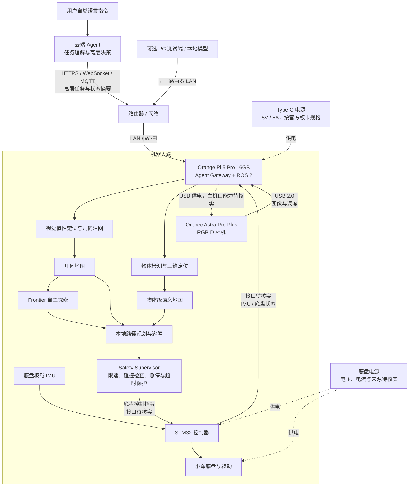

# 第一周：概要设计

第一周学生填写  2026年11月25日

**项目名称：** 云端 Agent 协同的 RGB-D 与 IMU 自主探索语义导航系统  
**组别：** 第三组　　**成员与分工：** 张岳豪、肖钰玥、尹思佳（具体分工待组内确认）

## 1 问题背景与具体目标

### 1.1 任务背景

室内移动机器人要先建立环境地图并识别物体，才能按“探索房间并找到会议桌”等自然语言指令完成任务。单靠人工遥控难以持续覆盖环境，云端模型又不适合处理实时定位和运动控制。本组拟使用 RGB-D 相机和 IMU 建立端侧定位、几何地图与物体级语义地图，再由云端 Agent 分解高层任务、由本地导航执行，重点验证探索到语义目标导航的闭环及断网时的安全性。

### 1.2 聚焦的问题与边界

**具体问题：** 在室内环境中，机器人如何融合 RGB-D 与 IMU 完成自主探索、物体语义建图，并依据自然语言任务导航到目标附近的安全位置？  
**输入：** 用户自然语言指令、彩色/深度图像、IMU 数据及机器人状态。  
**输出：** 几何地图、物体级语义地图、探索状态、安全目标位姿和导航结果。  
**工作条件：** 单台小车在室内运行，先完成传感器、坐标系和底盘接口核验。  
**边界：** 云端只提交高层任务，目标检查、避障、速度控制和急停由机器人端完成，不让云端直接下发底盘速度；多机器人协同及复杂室外环境暂不纳入本阶段。

### 1.3 四周目标与检查方法

**表1-1　四周里程碑与本组计划**

| 时间节点 | 阶段检查点 |
| :--- | :--- |
| 11月25日 | **香橙派环境搭建**；实现香橙派控制小车的基本运动；连接相机并验证图像数据读取。 |
| 12月2日 | 实现 SLAM 算法，完成室内定位与建图的初步验证。 |
| 12月9日 | 部署 YOLO 目标检测模型，完成目标识别的初步验证。 |
| 12月16日 | 搭建云端 Agent，实现云端任务请求与机器人端的基础交互。 |

## 2 系统结构与接口连接

**图2-1　云端 Agent 协同的 RGB-D 与 IMU 自主探索语义导航系统连接示意**

**供电与数据线说明：** 实线表示数据或控制连接，虚线表示供电；图中未确认的实际线缆、端口与参数需按设备铭牌、手册和实机测试核对。Orange Pi 5 Pro 官方规格为 Type-C 5V/5A；Astra Pro Plus 规格书列出 USB 2.0、USB 供电及最高 2.5W 功耗，需确认主机 USB 口供电能力。([Orange Pi 5 Pro 官方规格](https://www.orangepi.org/html/hardWare/computerAndMicrocontrollers/details/Orange-Pi-5-Pro.html)；[Astra Pro Plus 规格书](https://developer-orbbec-oss.oss-cn-shenzhen.aliyuncs.com/library/product_doc/Astra_Pro_Plus_Datasheet_v1.2.pdf))

**表2-1　接口与供电说明**

| 连接关系 | 接口与传输内容 | 供电及待确认事项 |
|---|---|---|
| Astra Pro Plus — Orange Pi 5 Pro | USB 2.0；相机向计算板传输彩色图像和深度数据 | 相机由 USB 供电；核对主机口电流能力、线缆和 Linux/ROS 2 驱动。相机规格书最大功耗 2.5W。 |
| 板载 IMU / STM32 — Orange Pi 5 Pro | 通过底盘控制器向计算板提供 IMU 与底盘状态；串口/USB 等实际接口待核实 | 板载 IMU 随底盘供电；核对控制板逻辑电平、协议、波特率及共地要求。 |
| Orange Pi 5 Pro — STM32 / 小车底盘 | 机器人端本地导航与安全模块向 STM32 发送控制指令，并接收底盘状态；实际接口待核实 | 底盘使用其配套电源；电压、电流、驱动器和急停接线待按铭牌及手册核实。电机不得由计算板 GPIO 直接供电。 |
| Orange Pi 5 Pro — 路由器 / 云端 Agent | Wi-Fi 或有线 LAN；HTTPS、WebSocket 或 MQTT 传输高层任务和状态摘要 | 网络设备独立供电；记录连接方式、地址与服务端口，不上传密码。 |
| Orange Pi 5 Pro — 可选 PC 测试端 | 同一路由器下经 LAN 传输测试请求或调试信息 | PC 独立供电；PC/本地模型为可选模块，不承担底盘实时控制。 |

**本组数据流程：** RGB-D 图像与深度、底盘 IMU → Orange Pi 上的 ROS 2 感知/定位与建图 → 几何地图和物体级语义地图 → Frontier 探索、语义目标位姿生成与本地导航 → Safety Supervisor 校验后经 STM32 控制底盘；云端 Agent 通过 Gateway 发起高层任务并接收状态摘要。

**待核实接口或供电问题：** 确认 Astra Pro Plus 的线缆及 Orange Pi USB 口供电能力、Linux/ROS 2 驱动；确认 STM32 与 Orange Pi 的通信接口和协议、IMU 数据格式与时间戳；核实 Orange Pi 电源适配器及底盘电池/驱动器的额定电压和电流。负责人：全组；完成实机检查后补记结果。

## 3 材料用途 成本与设备状态

**表3-1　材料用途与成本**

| 材料及型号 | 数量 | 单价 / 元 | 小计 / 元 | 预计用途及来源 |
|---|---:|---:|---:|---|
| Orbbec Astra Pro Plus RGB-D 深度相机 | 设备清单记载 1 台，待实物确认 | 待核实 | 待核实 | 彩色/深度采集；设备清单所列，购置或借用来源待确认 |
| 小车底盘 + STM32 + 板载 IMU | 设备清单记载 1 套，待实物确认 | 待核实 | 待核实 | 移动平台、惯性测量与底盘执行；设备清单所列，来源待确认 |
| Orange Pi 5 Pro 16GB + 64GB TF 卡 | 设备清单记载 1 套，待实物确认 | 待核实 | 待核实 | 运行 ROS 2、定位建图、语义感知、Gateway 与本地导航；设备清单所列，来源待确认 |
| **实际新增支出合计** | — | — | **待采购记录核实** | 当前未提供采购凭证或价格，不据此推定支出为零。 |

**本组当前实际支出：** 待核实（需按真实采购记录填写）　　**已有或借用设备：** 设备清单列有 Astra Pro Plus RGB-D 相机、小车底盘（含 STM32 与板载 IMU）及 Orange Pi 5 Pro 16GB（含 64GB TF 卡）；实物数量和借用/购置状态待确认。

**尚缺材料及预计新增支出：** 待实机核对相机 USB 线、Orange Pi 电源、底盘电源及通信线是否齐全；如需采购，再按型号、数量和实际报价登记。

**表3-2　设备状态记录**

| 检查项 | 当前状态 | 证据或问题 |
|---|---|---|
| 系统镜像与启动 | 未测 | Orange Pi 5 Pro 16GB + 64GB TF 卡；镜像版本、启动情况与供电状态待记录。 |
| 网络与 SSH | 未测 | 尚无 IP、路由器连接和登录结果记录；不得填写密码。 |
| 主要传感器读取 | 未测 | Astra Pro Plus 与底盘板载 IMU 尚无实测数据记录；待检查图像/深度、IMU 话题、时间戳及驱动。 |
| 执行器基本动作（如有） | 未测 | STM32 与小车底盘尚无动作记录；先核实底盘供电、通信接口和急停，再做低速测试。 |

**本周最需要协助的问题：** 获取并核对底盘 STM32 通信协议、IMU 数据格式及电气参数；确认 Orange Pi 系统镜像、相机驱动和 USB 供电能力。　　**跟进负责人：** 全组

